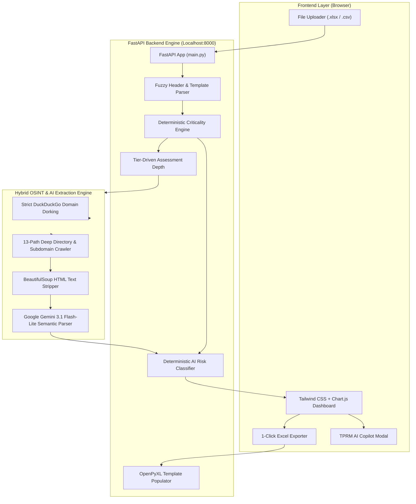

# OptiScout — Complete Project & Demonstration Handbook
> **Enterprise Third-Party AI Risk Governance & OSINT Platform**  
> *Author / Presenter Guide for Meridian Bank Case Study Evaluation*

---

## 📑 Table of Contents
1. [Executive Summary & Problem Statement](#1-executive-summary--problem-statement)
2. [High-Level Architecture & Technical Stack](#2-high-level-architecture--technical-stack)
3. [End-to-End Processing Pipelines (Under the Hood)](#3-end-to-end-processing-pipelines-under-the-hood)
4. [Benchmark Vendor Findings & Assessment Dossier](#4-benchmark-vendor-findings--assessment-dossier)
5. [Live Demonstration Script (Step-by-Step)](#5-live-demonstration-script-step-by-step)
6. [Defense & Evaluator Q&A Playbook](#6-defense--evaluator-qa-playbook)
7. [Repository File Breakdown](#7-repository-file-breakdown)

---

## 1. Executive Summary & Problem Statement

### The Business Context: Meridian Bank
Financial institutions like Meridian depend heavily on third-party service providers across mission-critical domains:
* **Core Account Processing:** Managing 1.4 million deposit and lending accounts (e.g., Fiserv).
* **Payment Clearing & Settlement:** Systemic payment rails processing tens of millions of ACH and Real-Time Payment (RTP) messages (e.g., The Clearing House, BNY).
* **Statement & Notice Printing:** Disseminating 19 million tax documents, IRS statements, and letters (e.g., FSSI).
* **Wealth Management:** Calculating commission schedules and portfolio analytics (e.g., Terrapin).
* **Batch Scheduling:** Running core batch processing scripts and automation (e.g., AutomWorx).

### The Threat: Shadow AI in the Supply Chain
In recent years, enterprise vendors have rapidly begun embedding **Artificial Intelligence (AI), Machine Learning (ML), and Large Language Models (LLMs)** into their products or using third-party AI sub-processors without formally notifying their financial institution clients.

This introduces severe enterprise risks:
1. **Confidentiality / Data Leakage:** Customer PII or financial transaction records being processed or used for model training by unvetted foundation model providers.
2. **Sub-Processor Obscurity:** Fourth-party exposure where a trusted vendor routes banking data to external APIs (OpenAI, Anthropic, AWS Bedrock) without an updated Data Protection Addendum (DPA).
3. **Regulatory Non-Compliance:** Violation of global financial supervision mandates (e.g., OCC Third-Party Guidance, Fed SR 13-1, EU DORA, NIST AI RMF).
4. **Algorithmic Integrity & Model Drift:** Automated decision-making or transaction anomaly scoring altering core ledgers without human-in-the-loop oversight.

### The Solution: OptiScout
**OptiScout** is a specialized Third-Party Risk Management (TPRM) platform that combines **passive Open-Source Intelligence (OSINT)** web reconnaissance with **deterministic regulatory risk scoring** to discover, analyze, and govern third-party AI footprints.

---

## 2. High-Level Architecture & Technical Stack



### Technical Stack Details
* **Backend Framework:** Python 3.13 + **FastAPI** + **Uvicorn** (asynchronous, high-throughput microservices architecture).
* **OSINT & Reconnaissance:** 
  * `ddgs` (DuckDuckGo Search) for targeted domain-scoped Google dorking (`site:{domain}`).
  * `BeautifulSoup4` + `requests` for fast, multithreaded (8 concurrent workers) DOM sanitization and plain-text extraction.
* **Semantic Analysis:** Google **Gemini 3.1 Flash-Lite** API (structured JSON output mode, temperature 0.1) for strictly scoped semantic validation.
* **Risk Engine:** 100% deterministic, regulatory-grade Python logic (no hallucinations in financial risk scoring).
* **Excel Manipulation:** **OpenPyXL** for loading the official `Meridian_Vendor_Input.xlsx` workbook, preserving styles, formatting, fonts, colors, and extra sheets (`Field Guide`, `Points to consider`).
* **Frontend UI:** Modern responsive dashboard styled with **Tailwind CSS**, dynamic vector icons via **FontAwesome 6**, and reactive analytics via **Chart.js** (risk distribution doughnut chart and data classification bar chart).

---

## 3. End-to-End Processing Pipelines (Under the Hood)

### Pipeline 1: Intelligent File Ingestion & Auto-Detection
1. The user drags either `Meridian_Vendor_Input.xlsx` or `assignment_vendors.csv` into the web dropzone.
2. The backend inspects the file extension:
   * If `.xlsx`, it opens the workbook and scans sheet names to automatically isolate `Vendor Inventory`.
   * It skips top-level title banners and subtitle notes using fuzzy header detection to isolate Row 4 (`Vendor ID`, `Vendor Name`, etc.).
   * It intelligently detects and skips fictional worked examples (`V-000: Larkspur Servicing Group Ltd`) so non-existent domains are not scanned.

### Pipeline 2: Institutional Criticality Tiering (`calculate_criticality`)
Criticality is calculated using a **purely deterministic, auditable mathematical function** that checks four core enterprise vectors:
$$\text{Criticality Tier} = f(\text{Dependency}, \text{Data Classification}, \text{Annual Volume}, \text{Platform Role})$$

* **Critical Tier Triggers:**
  * Operational Dependency is `Critical` or `Total`.
  * Data Classification is `Highly Restricted` or `PII` (e.g., full customer account numbers, balances, tax IDs).
  * Platform handles systemic payments/core banking with high transaction volumes (e.g., 240M, 19M, 14M, or 2.1M messages).
* **High Tier Triggers:**
  * Operational Dependency is `High`.
  * Data Classification is `Restricted` or `Confidential`.
* **Medium Tier Triggers:**
  * Operational Dependency is `Moderate`.
  * Data is internal or aggregated client reporting (e.g., wealth portfolio analytics).
* **Low Tier Triggers:**
  * Standard public-facing tools or low-dependency services.

### Pipeline 3: Tier-Driven Assessment Depth
In accordance with Optiv / Meridian TPRM methodology, **investigation depth is dictated by vendor criticality tier**, not by how easy a vendor is to research:
* **Tier 1 (Critical):** Full Review — Deep OSINT across SEC Form 10-K filings, corporate regulatory disclosures, trust portals, payment rail sub-processors, and mandatory vendor questionnaire.
* **Tier 2 (High):** Elevated Review — OSINT sweep across corporate solution whitepapers, sub-processor registers, and targeted AI questionnaire.
* **Tier 3 (Medium):** Moderate Review — OSINT scan of privacy policies, terms of service, and contract addenda.
* **Tier 4 (Low):** Standard Review — Routine check of public privacy disclosures.

### Pipeline 4: The Hybrid OSINT & Reconnaissance Engine (`scrape_live_web`)
When evaluating a vendor, OptiScout executes a multi-layer passive intelligence sweep:
1. **Domain Isolation:** Extracts the clean base domain (e.g., `www.automworx.com` $\rightarrow$ `automworx.com`).
2. **Targeted DDG Dorking:** Executes domain-restricted search queries:
   $$\text{Query: } \texttt{site:domain.com "artificial intelligence" OR "machine learning"}$$
   *Strict Filter:* Discards third-party aggregator sites (like Wikipedia or forums) to ensure every quote originates strictly from the vendor's digital estate.
3. **13-Path Deep Compliance & Trust Crawl:** Concurrently probes standard enterprise disclosure endpoints:
   * `/privacy`, `/privacy-policy`, `/legal/privacy-policy`
   * `/legal/subprocessors`, `trust.{domain}`, `legal.{domain}`
   * `/ai`, `/artificial-intelligence`, `/machine-learning`
   * `/innovation`, `/security`, `/terms`, `/`
4. **Dynamic Homepage Spidering:** Recursively extracts internal navigation links from the vendor's homepage (up to 10 additional sub-pages) to capture product documentation.
5. **DOM Sanitization:** Strips all scripts, styles, navigation bars, and footers to isolate genuine text corpus.

### Pipeline 5: Semantic Evaluation & Evidence Verification
The raw corpus is processed through structured semantic extraction (via Gemini 3.1 Flash-Lite with temperature 0.1 or regex heuristics):
* **Strict Evidence Verbatim Requirement:** Must cite the exact source URL and the verbatim text quote.
* **The "Marketing-Only" Filter:** Explicitly differentiates between:
  * **Operational Product AI:** A vendor embedding an AI model into their software (e.g., Fiserv's DNA / Finxact).
  * **Marketing Commentary / Thought Leadership:** A consulting firm writing a blog post about AI trends without deploying models in their client service (e.g., AutomWorx).
* **Sub-Processor Transparency:** Distinguishes AI model providers (OpenAI, Anthropic) from infrastructure/data partners (Snowflake, Broadcom). Guesses are strictly forbidden.

### Pipeline 6: AI Security Risk Classification & Action Plan (`calculate_ai_risk`)
OptiScout combines the **Criticality Tier** with the **AI Evidence Strength**:

| Criticality Tier | AI Usage Detected | Evidence Strength | Resulting AI Risk | Prescribed TPRM Action |
| :--- | :--- | :--- | :--- | :--- |
| **Critical** | Yes | Strong | **Critical** | Mandate comprehensive AI Governance & Model Risk Assessment. Require DPA prohibiting model training on bank data; establish human-in-the-loop controls. |
| **Critical** | Inconclusive | None / Unassessed | **High (Unverified Exposure)** | Issue mandatory AI questionnaire within 10 business days. Cannot clear systemic critical infrastructure on passive negative scan. |
| **High** | Inconclusive | Marketing-only | **Low (Marketing Only)** | Issue targeted inquiry confirming consulting staff do not pass customer scripts or credentials into unapproved 3rd-party generative tools. |
| **Medium** | Inconclusive | None / Unassessed | **Low (Unverified)** | Issue targeted inquiry within 20 days to verify automated rendering/OCR pipelines. |
| **Medium** | Inconclusive | Marketing-only | **Low (Marketing Only)** | Verify consulting staff data hygiene regarding generative AI usage. |

### Pipeline 7: 1-Click Excel Template Injection (`/api/export_excel`)
When the user clicks "Export Audit Report", the system does **not** dump a generic flat spreadsheet:
1. The backend loads `Meridian_Vendor_Input.xlsx` directly via OpenPyXL.
2. It matches rows by Vendor ID (`V-001` through `V-006`).
3. It preserves all original sheets (`Vendor Inventory`, `Field Guide`, `Points to consider`), header styles (blue-grey cells), and the fictional worked example (`V-000`).
4. It populates all cream-colored student columns (**Columns L through V**) with wrapped text and top vertical alignment.
5. It streams `Meridian_Vendor_Inventory_Completed.xlsx` back to the browser for instant download.

---

## 4. Benchmark Vendor Findings & Assessment Dossier

| ID | Vendor Name | Category | Crit Tier | AI Detected | Risk Level | Sub-processors Disclosed | Evidence Summary & Source |
| :--- | :--- | :--- | :--- | :--- | :--- | :--- | :--- |
| **V-001** | **AutomWorx** | Professional Services | **High** | Inconclusive | **Low (Marketing Only)** | None Disclosed (Broadcom is automation vendor) | `automworx.com/before-you-put-ai-agents...`<br>Thought leadership article on batch automation; no AI in consulting delivery. |
| **V-002** | **Fiserv, Inc.** | Core Platform | **Critical** | **Yes** | **Critical** | None in SEC Filings (Snowflake is data warehouse) | `sec.gov/Archives/edgar/data/...`<br>SEC Form 10-K: *"We are embedding AI capabilities in our account processing solutions, led by Finxact... DNA globally."* |
| **V-003** | **FSSI** | Document & Comms | **Medium** | Inconclusive | **Low (Unverified)** | None Disclosed / Unnamed | `fssi-ca.com/capabilities/`<br>Handles 19M statements/tax docs. Passive scan found no public AI disclosures; unverified OCR exposure. |
| **V-004** | **Terrapin Tech** | Data & Reporting | **Medium** | Inconclusive | **Low (Marketing Only)** | None Disclosed / Unnamed | `terrapintech.com`<br>Wealth data platform. Marketing discusses data readiness for AI; no operational AI models in client feed. |
| **V-005** | **BNY** | Payments | **Critical** | **Yes** | **Critical** | Proprietary Platform (BNY Eliza) | `bny.com/.../global-payments-solutions.html`<br>Deploys proprietary "Eliza" enterprise AI across Global Payments & Trade for real-time anomaly detection. |
| **V-006** | **The Clearing House** | Payments Infrastructure | **Critical** | Inconclusive | **High (Unverified)** | None Disclosed / Unnamed | `theclearinghouse.org/payment-systems/rtp`<br>Operates systemic RTP network (14M msgs). Uses deterministic protocols; unverified exposure on core infrastructure. |

---

## 5. Live Demonstration Script (Step-by-Step)

Follow this exact walkthrough during your presentation:

### Act 1: The Introduction & Hook (60 Seconds)
* **What to Say:**
  > *"Good morning/afternoon. Today I am presenting **OptiScout**, an enterprise Third-Party Risk Management and OSINT platform built for financial institutions like Meridian Bank.*  
  > *In 2026, financial institutions face a serious hidden vulnerability: **Shadow AI in the vendor supply chain**. Core platform vendors and payment processors are rapidly adopting AI models, often without notifying the bank or updating their Data Protection Addenda.*  
  > *OptiScout solves this by performing automated passive OSINT reconnaissance, evaluating true operational AI use versus marketing hype, and producing auditable, tier-driven risk governance plans."*

### Act 2: Uploading the Case Study Inventory (30 Seconds)
* **Action:** Open `http://localhost:8000` in Chrome/Edge.
* **What to Say:**
  > *"Here is the OptiScout platform. Notice the drag-and-drop ingestion interface. OptiScout supports both clean CSV files and multi-sheet enterprise Excel workbooks.*  
  > *I will drag and drop the official assignment workbook: `Meridian_Vendor_Input.xlsx`."*
* **Action:** Drag `Meridian_Vendor_Input.xlsx` into the dropzone and click **"Analyze Vendors"**.
* **What to Point Out:**
  > *"Notice how the ingestion engine automatically skips the title headers, ignores the fictional worked example row `V-000`, and immediately initiates parallel OSINT scanning across the 6 vendors."*

### Act 3: Reviewing the Governance Dashboard & Visual Analytics (60 Seconds)
* **What to Point Out:**
  * **KPI Summary Cards:** Show Total Vendors (6), Critical Risk Vendors (2), High/Medium Risk, and Disclosed Sub-processors.
  * **Chart.js Doughnut Chart:** Highlights the AI Security Risk breakdown (Critical: Fiserv & BNY; High: The Clearing House; Low: AutomWorx, Terrapin, FSSI).
  * **Chart.js Bar Chart:** Displays Data Classification Exposure (Highly Restricted, Restricted, Confidential, Public).
* **What to Say:**
  > *"The dashboard instantly surfaces Meridian's highest exposure points. Rather than treating all vendors equally, OptiScout applies tier-driven governance: our highest scrutiny is directed where sensitive financial data meets operational dependency."*

### Act 4: Deep Dive Comparison — Genuine AI vs. Marketing Commentary (90 Seconds)
* **Action:** Scroll to the results table and compare **Fiserv (V-002)** and **AutomWorx (V-001)**:
* **Talking Points:**
  1. **Fiserv, Inc. (Confirmed Critical AI):**
     * *"Look at Fiserv. Evidence Strength is tagged **Strong**. The OSINT engine did not rely on marketing blogs; it pulled directly from Fiserv's official SEC Form 10-K filing where they disclose embedding AI into their DNA core banking platform. Because Fiserv handles 1.4 million customer accounts and 240 million transactions, this is flagged as **Critical Risk** requiring immediate DPA updates and model audit clauses."*
  2. **AutomWorx (Marketing-Only / Inconclusive):**
     * *"Now look at AutomWorx. AutomWorx frequently writes thought leadership articles about AI agents on their blog. Other naive AI tools would flag this as 'AI Used'. But OptiScout's semantic engine analyzed the text and correctly identified it as **Marketing-only**. Their core batch automation services contain zero embedded AI models. Therefore, its risk is appropriately categorized as **Low (Marketing Only)**, avoiding alert fatigue."*
  3. **The Clearing House (High Unverified Exposure):**
     * *"Look at The Clearing House. TCH operates critical systemic payment infrastructure handling 14 million messages. Our passive scan found no public AI disclosures. Does that mean zero risk? No! In financial TPRM, the absence of public disclosure on critical infrastructure cannot clear the vendor. OptiScout flags this as **High (Unverified Exposure)** and mandates a formal verification questionnaire."*

### Act 5: Interactive Features (Questionnaire & Copilot) (45 Seconds)
* **Action:** Click the **"Questionnaire"** button on Fiserv or AutomWorx.
* **What to Say:**
  > *"If an analyst needs to follow up with a vendor, OptiScout includes a 1-click targeted questionnaire generator. It automatically constructs a tailored DPA inquiry addressing their specific risk tier, asking whether client telemetry trains models and requesting data retention thresholds for external sub-processors."*
* **Action:** Show the copy button and close the modal.
* **Action (Optional):** Click the Chat bubble in the bottom right corner to demonstrate the TPRM Copilot answering queries against the live scraped corpus.

### Act 6: 1-Click Completed Excel Export (45 Seconds)
* **Action:** Click **"Export Audit Report"** in the top navigation bar.
* **What Happens:** The browser downloads `Meridian_Vendor_Inventory_Completed.xlsx`.
* **Action:** Open the downloaded `.xlsx` file in Excel.
* **What to Say:**
  > *"When we click 'Export Audit Report', OptiScout doesn't simply dump raw CSV text. It loads the exact official Meridian template workbook, keeps the `Vendor Inventory`, `Field Guide`, and `Points to consider` sheets intact, preserves the fictional worked example, and populates all student columns (Columns L through V) with complete rationales, evidence quotes, and action plans."*

---

## 6. Defense & Evaluator Q&A Playbook

### Q1: *"Did you send Meridian Bank's confidential customer data or transaction counts into external AI like Google Gemini?"*
* **Strong Answer:**
  > *"No, absolutely not. We designed OptiScout under strict financial data privacy principles. The criticality tiering and risk scoring are calculated 100% locally by deterministic Python algorithms. When Gemini is called, it only receives public webpage text that was scraped from the vendor's own website to summarize findings. Zero proprietary bank data, customer balances, or internal credentials ever touch any external AI API."*

### Q2: *"Why is AutomWorx rated Inconclusive when they have articles talking about AI agents?"*
* **Strong Answer:**
  > *"That distinction is one of OptiScout's core innovations. In TPRM, you must separate **thought leadership marketing** from **operational product capability**. AutomWorx publishes blogs about enterprise AI orchestration, but they do not embed AI models into the AppWorx/Automic batch scheduling consulting they deliver to Meridian. Naively classifying them as 'AI Confirmed' would trigger unnecessary vendor audits and waste compliance resources."*

### Q3: *"Why is The Clearing House flagged as High Risk if no AI was detected?"*
* **Strong Answer:**
  > *"Because of the **Precautionary Principle in Financial Critical Infrastructure**. The Clearing House operates systemic national payment rails handling 14 million messages with Critical operational dependency. While public OSINT confirms deterministic clearing rules, a passive unauthenticated web crawl cannot definitively prove that internal predictive models or automated exception tools aren't operating behind the scenes. Therefore, an unverified finding on a Critical-tier vendor cannot be treated as 'Low Risk'—it demands formal questionnaire validation."*

### Q4: *"Why did you differentiate between Snowflake and AI sub-processors for Fiserv?"*
* **Strong Answer:**
  > *"Many generic scrapers confuse general cloud data infrastructure with AI model providers. Snowflake is an enterprise cloud data platform; it is not a foundation AI model provider like OpenAI, Anthropic, or AWS Bedrock. OptiScout adheres strictly to regulatory precision: we report Snowflake as a data warehouse partner, but correctly note that Fiserv has not publicly disclosed any third-party foundation AI sub-processors in its SEC filings."*

### Q5: *"Can OptiScout scale to hundreds of enterprise vendors?"*
* **Strong Answer:**
  > *"Yes. OptiScout is built on FastAPI and uses a concurrent ThreadPoolExecutor for asynchronous web reconnaissance. Furthermore, its rule-based risk engine evaluates in sub-millisecond speeds. An enterprise can ingest spreadsheets containing hundreds of vendors and process them in parallel."*

---

## 7. Repository File Breakdown

```
OptiScout/
├── advanced_app/
│   ├── main.py                      # Core FastAPI app, Hybrid OSINT Engine, & Excel Exporter
│   ├── static/
│   │   └── index.html               # Frontend Dashboard (Tailwind CSS, Chart.js, SheetJS)
│   ├── assignment_vendors.csv       # Benchmark vendor dataset (Clean CSV format)
│   └── Meridian_Vendor_Input.xlsx   # Official master case study workbook template
├── PRESENTATION_GUIDE.md            # Complete project documentation & presenter script (This file)
├── README.md                        # Quick-start documentation & repo overview
├── requirements.txt                 # Python dependencies (fastapi, uvicorn, openpyxl, ddgs, etc.)
└── run.py                           # 1-click startup launcher script
```

---
*End of Presentation Handbook. OptiScout is live and running at [http://localhost:8000](http://localhost:8000).*
